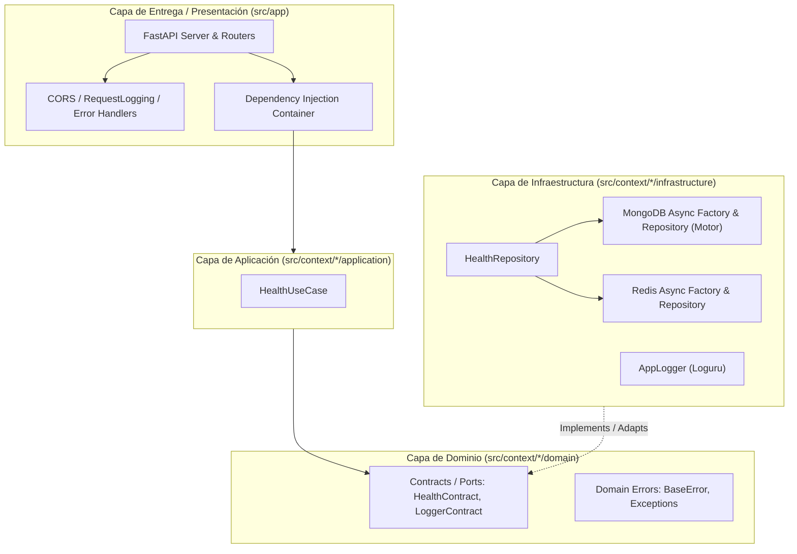

# Análisis Arquitectónico - Backend Template Python

## 1. Identificación de la Arquitectura General

### Patrón Arquitectónico Principal: **Arquitectura Limpia (Clean Architecture) con DDD y Puertos & Adaptadores**

Esta plantilla implementa una **Arquitectura Limpia (Clean Architecture)** con principios de **Diseño Orientado al Dominio (Domain-Driven Design - DDD)** y el patrón de **Puertos y Adaptadores (Hexagonal Architecture)** en Python 3.11+ utilizando **FastAPI** y **uv**.

Es la adaptación directa a Python del `backend-template` (Node.js/TypeScript), manteniendo los mismos principios de desacoplamiento, testabilidad y aislamiento del núcleo de negocio.

---

## 2. Separación de Conceptos por Capas

El proyecto se estructura en dos árboles principales:

1. **`src/app/`**: Capa de entrega web y configuración del framework (FastAPI, enrutamiento, middlewares, manejo global de errores, inyección de dependencias y ciclo de vida ASGI `lifespan`).
2. **`src/context/`**: Bounded Contexts del dominio de negocio. Cada contexto es autónomo y cuenta con:
   - `domain/`: Entidades, errores de dominio y contratos abstractos (puertos) sin dependencias de frameworks externos.
   - `application/`: Casos de uso que orquestan la lógica de negocio dependiendo únicamente del dominio.
   - `infrastructure/`: Adaptadores concretos (MongoDB con `motor`, Redis con `redis.asyncio`, logging con `loguru`).

---

## 3. Bounded Contexts

### 3.1. Contexto `health` (Salud y Observabilidad)
- **Contrato (`domain/health_contract.py`)**: `HealthContract` define la interfaz abstracta `get()`.
- **Caso de Uso (`application/health_use_case.py`)**: `HealthUseCase` coordina la consulta de estado a través del contrato.
- **Infraestructura (`infrastructure/health_repository.py`)**: `HealthRepository` extiende `MongoRepository` e implementa `HealthContract`, verificando de forma asíncrona la conectividad con MongoDB y Redis mediante `ping()`.

### 3.2. Contexto `shared` (Shared Kernel)
- `domain/base_error.py`: Clase base `BaseError` para el manejo homogéneo de excepciones de dominio y aplicación.
- `domain/exceptions.py`: Excepciones tipadas (`ResourceNotFoundError`, `InvalidArgumentError`, `DatabaseConnectionError`).
- `domain/logger_contract.py`: Contrato abstracto `LoggerContract`.
- `infrastructure/persistence/mongo/`: Factory (`MongoClientFactory`), configuración (`MongoConfig`) y repositorio base genérico (`MongoRepository`) utilizando `motor.motor_asyncio`.
- `infrastructure/persistence/redis/`: Factory (`RedisClientFactory`), configuración (`RedisConfig`) y repositorio base (`RedisRepository`) utilizando `redis.asyncio`.
- `infrastructure/logger/app_logger.py`: Implementación `AppLogger` con soporte para `loguru` y fallback a `logging` estándar.

---

## 4. Principios SOLID Aplicados

- **S - Single Responsibility Principle (SRP)**: Cada clase tiene una única responsabilidad (`MongoClientFactory` gestiona el pool de conexiones de Mongo, `HealthUseCase` ejecuta el caso de uso de salud, `RequestLoggingMiddleware` registra tiempos de respuesta).
- **O - Open/Closed Principle (OCP)**: Nuevos Bounded Contexts pueden agregarse bajo `src/context/<nuevo_contexto>` y registrarse en `src/app/routes/index.py` sin modificar la estructura existente.
- **L - Liskov Substitution Principle (LSP)**: Cualquier implementación de `HealthContract` (por ejemplo `DummyHealthRepo` en tests o `HealthRepository` en producción) es intercambiable sin alterar `HealthUseCase`.
- **I - Interface Segregation Principle (ISP)**: Contratos específicos y cohesivos por dominio (`HealthContract`, `LoggerContract`).
- **D - Dependency Inversion Principle (DIP)**: Los casos de uso dependen de abstracciones (`HealthContract`), nunca de implementaciones concretas (`HealthRepository`, `Motor`, `Redis`).
